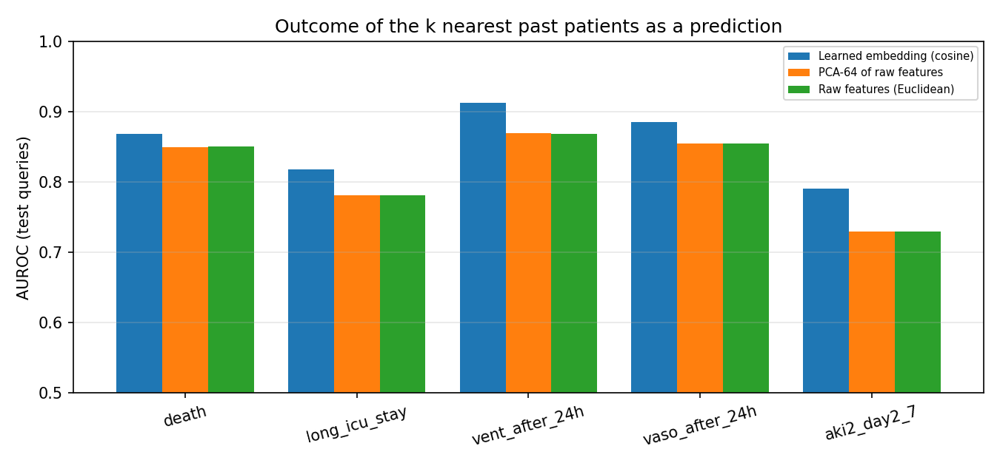
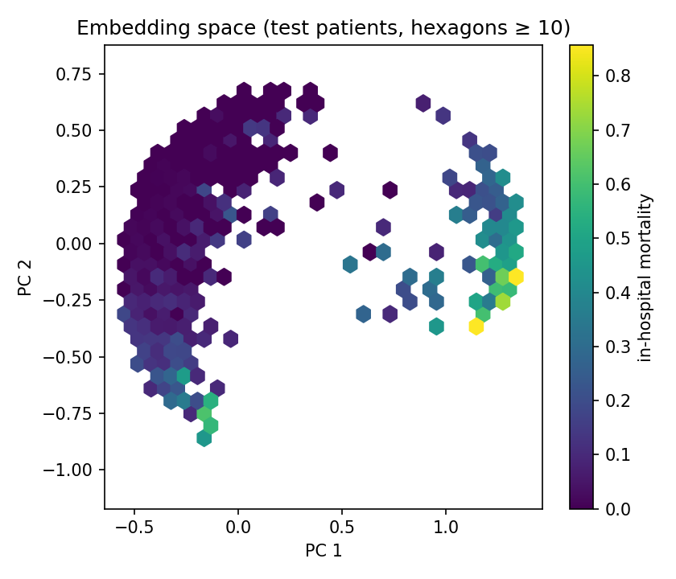

# Results — ICU patient similarity search (MIMIC-IV)

**Database:** 75,672 adult ICU stays ≥ 24 h (full MIMIC-IV), split by patient
70/15/15. Each stay becomes a 64-d embedding of its first
24 h (hourly vitals + first-day labs, SOFA, GCS, urine, weight, Charlson). The training split is the
searchable "past patients" index (FAISS, cosine); test patients are the queries.
**Outcomes (after the first 24 h):** in-hospital death, ICU stay > 7 days, invasive ventilation, vasopressor,
AKI stage ≥ 2 (days 2–7).

## Data
| part | stays | death | long_icu_stay | vent_after_24h | vaso_after_24h | aki2_day2_7 |
|---|---|---|---|---|---|---|
| train | 52,892 | 0.119 | 0.148 | 0.254 | 0.205 | 0.447 |
| val | 11,394 | 0.118 | 0.143 | 0.245 | 0.202 | 0.451 |
| test | 11,386 | 0.117 | 0.145 | 0.256 | 0.209 | 0.446 |

## Do similar past patients predict what happens next?
Outcome rate among the k = 50 nearest past patients, used as a risk score → AUROC on test queries.
"Encoder heads" = the network's own direct prediction (upper reference).

| outcome | Encoder heads (direct prediction) | Learned embedding (cosine) | PCA-64 of raw features | Raw features (Euclidean) |
|---|---|---|---|---|
| aki2_day2_7 | 0.798 | 0.791 | 0.729 | 0.729 |
| death | 0.886 | 0.869 | 0.850 | 0.850 |
| long_icu_stay | 0.832 | 0.818 | 0.782 | 0.781 |
| vaso_after_24h | 0.898 | 0.885 | 0.855 | 0.855 |
| vent_after_24h | 0.923 | 0.913 | 0.869 | 0.869 |

**Lift@10:** for test patients who had the outcome, how many times more often their 10 nearest
neighbours had it than a random past patient.

| outcome | Learned embedding (cosine) | PCA-64 of raw features | Raw features (Euclidean) |
|---|---|---|---|
| aki2_day2_7 | 1.352 | 1.096 | 1.097 |
| death | 3.369 | 2.101 | 2.106 |
| long_icu_stay | 2.292 | 1.653 | 1.652 |
| vaso_after_24h | 2.811 | 1.899 | 1.900 |
| vent_after_24h | 2.657 | 1.712 | 1.713 |

## Embedding space

## Speed (FAISS)
| database_size | exact_ms_per_query | ivfpq_ms_per_query | ivfpq_recall_at_10 | ivfpq_bytes_per_patient |
|---|---|---|---|---|
| 52,892 | 0.074 | 0.049 | 0.348 | 16 |

## Demo query (hypothetical patient, not a real record)
Input: age=72, female=0, sofa=9, cardiovascular=3, respiration=2, renal=2, creatinine_max=2.4, bun_max=48, wbc_max=18, platelets_min=110, gcs_min=13, hr=112, mbp=62, sbp=92, rr=26, spo2=93, temp=38.4, first_careunit=Medical Intensive Care Unit (MICU), admission_type=EW EMER.

|  | value |
|---|---|
| death among 50 most similar | 0.460 |
| long_icu_stay among 50 most similar | 0.640 |
| vent_after_24h among 50 most similar | 0.920 |
| vaso_after_24h among 50 most similar | 1.000 |
| aki2_day2_7 among 50 most similar | 0.720 |
| mean cosine similarity | 0.972 |

---
Encoder best epoch 18 · runtime 0.8 min. Aggregate results only; the index and the
encoder stay private (the index holds embeddings of real patients). This is a decision-support prototype, not a
clinical tool.
